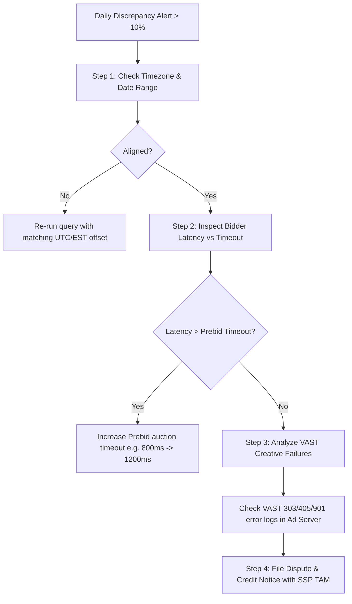

# Ad Operations Standard Operating Procedures (SOP) & Knowledge Base
**Platform:** VDO.AI / Programmatic Video & Display Operations  
**Target Role:** Associate – Ad Operations  
**Author:** Ad Operations Candidate  

---

## Table of Contents
1. [Overview & Scope](#1-overview--scope)
2. [SOP 101: Triaging Partner Discrepancy (>10%)](#2-sop-101-triaging-partner-discrepancy-10)
3. [SOP 102: Investigating Sudden Revenue / eCPM Drops](#3-sop-102-investigating-sudden-revenue--ecpm-drops)
4. [SOP 103: Video Ad Quality & VAST Error Code Reference](#4-sop-103-video-ad-quality--vast-error-code-reference)
5. [SOP 104: Header Bidding (Prebid.js) Timeout & Floor Price Optimization](#5-sop-104-header-bidding-prebidjs-timeout--floor-price-optimization)

---

## 1. Overview & Scope
This operational handbook serves as the frontline troubleshooting guide for daily Ad Operations management. It establishes rigorous diagnostic procedures to safeguard publisher revenue, minimize demand partner discrepancies, and uphold high video ad rendering standards.

---

## 2. SOP 101: Triaging Partner Discrepancy (>10%)

### 2.1 Definition
**Discrepancy Formula:**
$$\text{Discrepancy (\%)} = \frac{\text{Ad Server Impressions} - \text{SSP Reported Impressions}}{\text{Ad Server Impressions}} \times 100$$

* **Safe (<5%):** Normal latency and network drop-off.
* **Moderate (5% - 10%):** Acceptable variance across cross-regional CDNs.
* **Critical (>10%):** Immediate technical triage required. Violates standard Master Services Agreement (MSA) SLA.

### 2.2 Step-by-Step Resolution Workflow

1. **Step 1: Validate Reporting Dimensions & Timezones**
   - Demand partners (e.g., Google AdX, Magnite, PubMatic) frequently report in Pacific Time (PST) or UTC, whereas Google Ad Manager (GAM) may be set to Eastern Time (EST).
   - Re-align daily reporting queries to 24-hour UTC intervals before flagging.

2. **Step 2: Analyze Bidder Latency vs. Prebid Timeout**
   - If an SSP's average response latency is $950\text{ms}$ while the client-side header bidding auction timeout is configured at $800\text{ms}$, bids arriving after the cutoff are discarded by Prebid.
   - *Action:* Temporarily raise bidder timeout in Prebid config or request server-to-server (S2S / Prebid Server) connection for the partner.

3. **Step 3: Video Tracking Pixel & Wrapper Audit**
   - For video ads (Outstream / In-stream), ad server fires the impression pixel on video start (first frame). If the SSP waits for the 2-second MRC viewability threshold or an end-card, counts diverge.
   - Verify that the SSP's creative wrapper does not contain excessive daisy-chained redirects (maximum 3 VAST wrapper hops).

4. **Step 4: Formal Dispute & Credit Notice**
   - Pull hourly log exports (`date`, `placement_id`, `ad_server_imps`, `ssp_imps`, `delta`).
   - If discrepancy persists above 10% for over 3 business days, submit a formal reconciliation ticket to the SSP Technical Account Manager (TAM) requesting make-good credit.

---

## 3. SOP 102: Investigating Sudden Revenue / eCPM Drops

### 3.1 Trigger
A publisher site or ad format experiences an overnight drop in revenue or eCPM $> 15\%$.

### 3.2 Diagnostic Checklist
1. **Dimension Isolation:**
   - Run a multi-dimensional pivot: Filter by `Device` (Mobile vs. Desktop), `Geography` (Tier 1 vs. Tier 3), and `Ad Format`.
   - *Example:* If eCPM dropped exclusively on Desktop In-Stream in US, issue is buyer-specific, not site-wide.
2. **Unified Pricing Rules (Floor Prices) Audit:**
   - Verify whether floor price rules were altered. Setting floor prices too high causes fill rates to collapse; setting floors too low allows DSP auto-bidders to shave margins.
3. **Ads.txt & SupplyChain Object Crawl:**
   - Verify that `publisher.com/ads.txt` is accessible (HTTP 200) and contains valid `DIRECT` or `RESELLER` entries for the affected SSPs. Any DNS or crawler failure drops programmatic DSP bids to zero.
4. **Viewability & Layout Integrity:**
   - Check if a publisher frontend release shifted ad containers below the fold, causing Viewability to drop below the 50% DSP procurement threshold.

---

## 4. SOP 103: Video Ad Quality & VAST Error Code Reference

Digital video advertising relies on the IAB VAST (Video Ad Serving Template) protocol. Ad Ops engineers must diagnose VAST error spikes immediately:

| Error Code | Error Description | Root Cause | Ad Ops Resolution |
| :--- | :--- | :--- | :--- |
| **VAST 303** | No Ad response (Empty VAST) | SSP returned an empty wrapper; no bid cleared floor price. | Lower floor price slightly or add waterfall backfill line item. |
| **VAST 403** | Unsupported video format / codec | Buyer submitted an `.flv` or unsupported `.mp4` bitrate on mobile devices. | Set line item creative transcoding requirements in ad server to standard H.264/MP4. |
| **VAST 405** | MediaFile display error | Video creative failed to render inside player container. | Check player dimension sizing; ensure `playsinline` and `muted` attributes are enabled for iOS Safari. |
| **VAST 901** | General VPAID Error | JavaScript VPAID tag crashed, blocked by ad blocker, or exceeded script load timeout. | Phase out legacy VPAID tags in favor of modern Open Measurement (OMID) / SIMID standards. |

---

## 5. SOP 104: Header Bidding (Prebid.js) Timeout & Floor Price Optimization

1. **Client-side vs. Server-to-Server (Prebid Server):**
   - Use client-side bidders for top 3 revenue drivers (e.g. Google AdX, Magnite, PubMatic) to preserve cookie matching rates.
   - Route secondary bidders through Prebid Server to reduce user browser memory footprint and keep total page load latency $< 1.8\text{s}$.
2. **Dynamic Floor Price Testing:**
   - Execute A/B floor price tests: Group A (Fixed $2.00 floor) vs Group B (Dynamic Machine-Learning floor adjusted by device/geo).
   - Target: Maximize Yield ($\text{Fill Rate} \times \text{eCPM}$).
